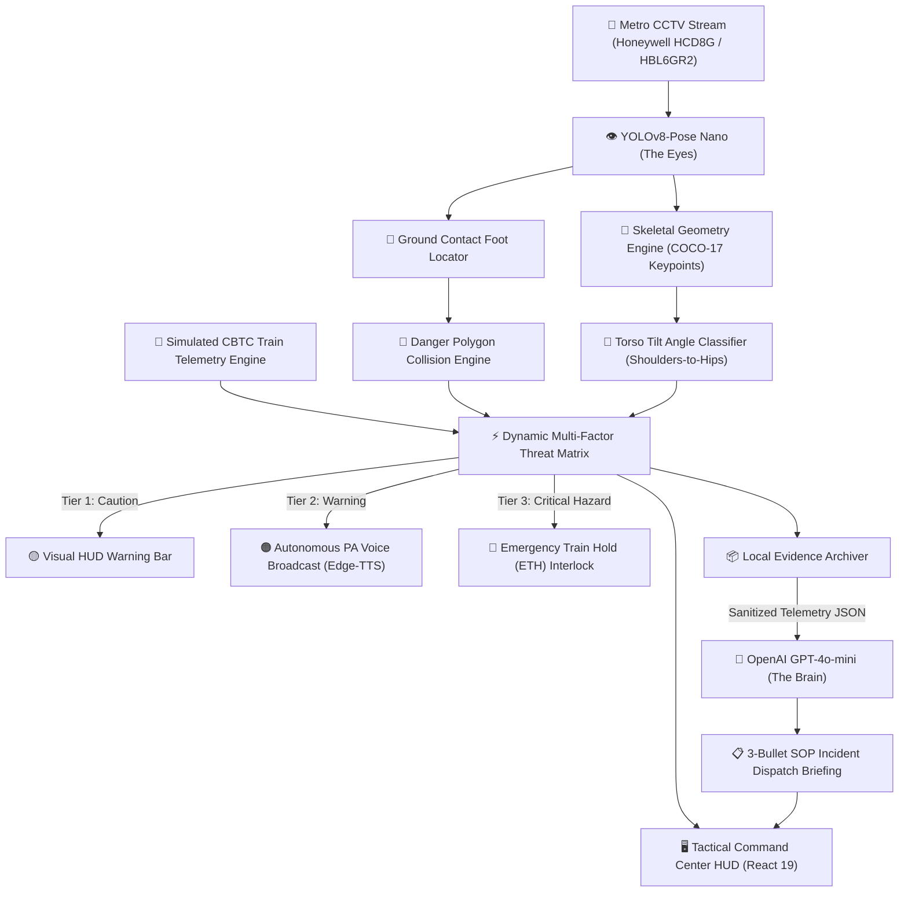

# MetroGuard AI — Next-Gen Autonomous Metro Platform Safety Copilot
### 🚇 DevDays Pune Metro Hackathon 2026 — AI & Computer Vision Safety Track

[](https://fastapi.tiangolo.com/)
[](https://react.dev/)
[](https://github.com/ultralytics/ultralytics)
[](https://openai.com/)
[](LICENSE)

> **"Transforming passive metro CCTV into an active autonomous guardian that intervenes in the critical 15–30 seconds before train impact."**

---

## 🎯 Executive Summary & Pune Metro Problem Statement

Traditional metro CCTV surveillance is **purely forensic**—it records platform slips, falls, and intrusions for post-incident review after an injury or casualty has already occurred. In high-density transit hubs like **Pune Metro Line 1 (PCMC to Swargate) and Line 2 (Vanaz to Ramwadi)**, platform crowding, rushed interchanges, and narrow platform edges pose acute passenger safety hazards.

**MetroGuard AI** addresses the core challenge defined in the **Pune Metro DevDays Safety Brief**:
1. **Platform & Track Fall Detection:** Real-time skeletal posture intelligence to differentiate routine yellow-line waiting from critical track collapse, faint, or push incidents.
2. **Escalator & Threshold Safety:** Multi-point skeletal kinematics analyzing posture angle and downward momentum.
3. **Restricted Zone & Loitering Control:** Dynamic N-point polygon intrusion detection near track beds, pump rooms, and electrical DG rooms.
4. **Platform Edge Crowd Surge & Heatmap Analysis:** Gaussian spatial density mapping to detect dangerous bottleneck crowding before stampede hazards materialize.
5. **Contextual Action, Not Passive Alerts:** Synchronization with **CBTC (Communications-Based Train Control)** arrival telemetry to trigger automatic localized **bilingual Public Address (PA) broadcasts (English + Hindi/Marathi)** and simulated **Emergency Train Hold (ETH)** interlocks.

---

## 🏗️ System Architecture: The "Eyes & Brain" Paradigm

MetroGuard AI separates high-throughput edge perception from cognitive reasoning:



### 1. 👁️ The Eyes — Local Edge Computer Vision
- **Inference Model:** YOLOv8-Pose Nano (`yolov8n-pose.pt`) optimized for low-latency 25+ FPS execution on commodity CPU/GPU.
- **Tracking Algorithm:** Multi-object persistent ByteTrack assigning consistent IDs to individual passengers.
- **Posture Analysis:** Computes the torso tilt vector ($\ge 60^\circ$ relative to vertical axis) from shoulder (indices 5, 6) and hip (indices 11, 12) landmarks to identify collapses and falls.
- **Foot Ground Localization:** Ankle landmark interpolation (indices 15, 16) mapped to normalized polygon coordinates ($pointPolygonTest$).

### 2. ⚡ The Spatial & Threat Matrix
- **Dynamic Threat Score ($0 - 100\%$):** Evaluates posture, boundary dwell frame duration, and oncoming train ETA countdown ($< 45\text{s}$ triggers maximum escalation).
- **Escalation Tiers:**
  - **Tier 1 (Caution):** Brief platform edge boundary crossing; Train ETA $> 90\text{s}$.
  - **Tier 2 (Warning):** Persistent intrusion ($> 15\text{ frames}$); Train ETA $45\text{s} - 90\text{s}$.
  - **Tier 3 (Critical Emergency):** Track fall confirmed OR zone breach with train approaching ($< 45\text{s}$).

### 3. 🧠 The Brain — OpenAI Cognitive Reasoning & SOP Copilot
- **Privacy-by-Design:** Raw video footage and passenger faces **never leave the local machine**. Only anonymized numerical telemetry is passed to the LLM.
- **3-Bullet Dispatch Briefing:** Produces an instant, actionable SOP report:
  1. **Observed Facts:** Verified telemetry (track ID, camera, dwell duration, torso tilt angle, train ETA).
  2. **Threat Assessment & Severity Rating:** Quantified operational risk.
  3. **Standard Operating Procedure (SOP) Actions:** Specific directives for the Station Controller and roaming Platform Marshals.
- **Offline Resilient Fallback:** Automatically switches to deterministic, rule-based SOP generation if the OpenAI key or network connection is unavailable.

---

## 💻 Tactical Station Operations Command Center (React UI)

MetroGuard AI replaces clunky CV preview windows with an **operator-grade, dark-mode Tactical Command HUD** engineered for control rooms:

| Module | Purpose | Live Capabilities |
|---|---|---|
| **CCTV Tactical Stream** | Real-time visual monitoring | Live MJPEG stream with toggleable overlays: **Danger Polygon**, **Skeletal Pose**, and **Crowd Density Heatmap**. |
| **CBTC Telemetry Cards** | Train synchronization | Live inbound train countdown (seconds), train speed (km/h), tracked passenger count, and vision FPS. |
| **Signal Interlock System** | Train collision prevention | One-click **Emergency Train Hold (ETH)** assertion and station operator acknowledgment/reset. |
| **Autonomous PA Agent** | Directed voice intervention | Automated bilingual speech generation (English + Hindi/Marathi) with mute toggle and test broadcast. |
| **Incident Archive Feed** | Audit & evidence trail | Instant modal review displaying dual evidence frames (`evidence.jpg` and `pose_overlay.jpg`), audio broadcast, and SOP report. |
| **Station Copilot Chat** | Natural language Q&A | Conversational assistant allowing operators to query recent telemetry and summarize safety events. |

---

## 📁 Standardized Evidence Packaging Format

Every detected incident is packaged and preserved locally in `output/events/<event_id>/`:

```text
output/events/EVT-152042-3/
├── event.json            # Structured machine-readable telemetry record
├── evidence.jpg          # High-resolution annotated CCTV evidence frame
├── pose_overlay.jpg      # Skeletal keypoint diagnostic snapshot
├── announcement.mp3      # Autonomous synthesized voice broadcast
└── report.md             # OpenAI Copilot 3-bullet SOP incident report
```

Sample `event.json`:
```json
{
  "event_id": "EVT-152042-3",
  "event_type": "track_fall",
  "severity": "critical",
  "threat_score": 98,
  "timestamp_utc": "2026-10-24T09:50:42.124Z",
  "camera_id": "Platform 2 - North Edge (Pune Metro Vanaz)",
  "track_id": 3,
  "torso_tilt_degrees": 78.4,
  "dwell_frames": 22,
  "train_eta_seconds": 38,
  "train_hold_asserted": true,
  "announcement_script": "Emergency alert: Person down near track bed on Platform 2. All passengers stand back. Train hold requested for Metro 104."
}
```

---

## 🚀 Quickstart & Demonstration Guide

### Prerequisites
- Python 3.11+
- Node.js 18+ (tested on v24)
- Local weights file: `yolov8n-pose.pt` (auto-loaded in project root)

### 1. Installation
```powershell
# Clone the repository
git clone https://github.com/amey-apankar/metroguard-ai.git
cd metroguard-ai

# Install Python backend dependencies
pip install -r requirements.txt

# Install and build the React Dashboard
cd web
npm install
npm run build
cd ..
```

### 2. Launch the Tactical Command Center (Recommended)
```powershell
python -m uvicorn metroguard.server:app --app-dir src --host 127.0.0.1 --port 8000
```
Open your browser and navigate to:
👉 **[http://localhost:8000](http://localhost:8000)**

### 3. Launch the Streamlit Reviewer (Alternative)
```powershell
streamlit run app.py
```

---

## 🏆 Pune Metro Hackathon Demonstration Flow (Judging Walkthrough)

To present MetroGuard AI to judges, follow this 4-step sequence:

1. **Step 1: Normal Platform Operations (Nominal State)**
   - Open **`http://localhost:8000`**.
   - Show the smooth CCTV stream running at 20+ FPS with translucent green platform edge boundary and ByteTrack passenger IDs.
   - Point out the CBTC Train ETA ticking down in real time.
2. **Step 2: Platform Loitering (Tier 2 Warning)**
   - As a passenger lingers inside the edge boundary past dwell threshold, the zone transitions to amber.
   - Automated PA warning script triggers: *"Attention Platform 2: Passenger near edge zone, please step behind the yellow line..."*
3. **Step 3: Track Fall Emergency (Tier 3 Critical)**
   - When a person falls or collapses ($\ge 60^\circ$ torso tilt) inside the danger zone with train ETA $< 45\text{s}$:
   - Visual HUD flashes emergency red: **`CRITICAL HAZARD: PERSON FALLEN ON TRACK BED`**.
   - **`EMERGENCY TRAIN HOLD`** interlock is asserted automatically.
   - Emergency bilingual PA audio broadcast speaks aloud.
4. **Step 4: Evidence Inspection & OpenAI Copilot**
   - Click the event in the **Incident Log Archive**.
   - Review side-by-side snapshots (`evidence.jpg` vs `pose_overlay.jpg`), listen to the audio broadcast, and examine the instant 3-bullet OpenAI SOP dispatch report.
   - Type a query into the **Station Copilot Chat** (e.g., *"Summarize safety incidents on Platform 2"*).

---

## 🛠️ Technology Stack

| Layer | Component | Specification |
|---|---|---|
| **Vision Inference (Eyes)** | Ultralytics YOLOv8-Pose | Nano variant (`yolov8n-pose.pt`), 17 skeletal keypoints |
| **Object Tracking** | ByteTrack | Multi-object persistent ID assignment |
| **Backend API & Streaming** | FastAPI & Uvicorn | Asynchronous Python 3.11+, MJPEG multipart stream |
| **Tactical Dashboard** | React 19 + Vite | Custom dark tactical HUD, Lucide icons, responsive layout |
| **Audio PA Agent** | Edge-TTS / pyttsx3 | Asynchronous bilingual voice synthesizer |
| **AI Reasoning (Brain)** | OpenAI API (`gpt-4o-mini`) | Structured SOP report generator with offline template fallback |
| **Spatial Geometry** | OpenCV & NumPy | Polygon collision detection & Gaussian crowd heatmaps |

---

## 🔒 Security, Safety & Privacy Disclaimer

- **Privacy Compliance:** Video frames are processed strictly in-memory on the edge device. No facial recognition is performed; no imagery leaves the station server.
- **Operational Prototype:** Signalling interlocks and PA audio triggers are simulated decision-support hooks designed for operator assistance. MetroGuard AI does not replace certified railway SIL-4 vital signalling systems.
- **Zero API Key Leakage:** API keys are processed strictly on the backend and are never exposed in client bundles or public endpoints.

---

## 👥 Authors & Acknowledgments

Developed with dedication for the **DevDays Pune Metro Hackathon 2026**.  
Advancing public transit safety through local-first computer vision and autonomous AI co-pilots.
