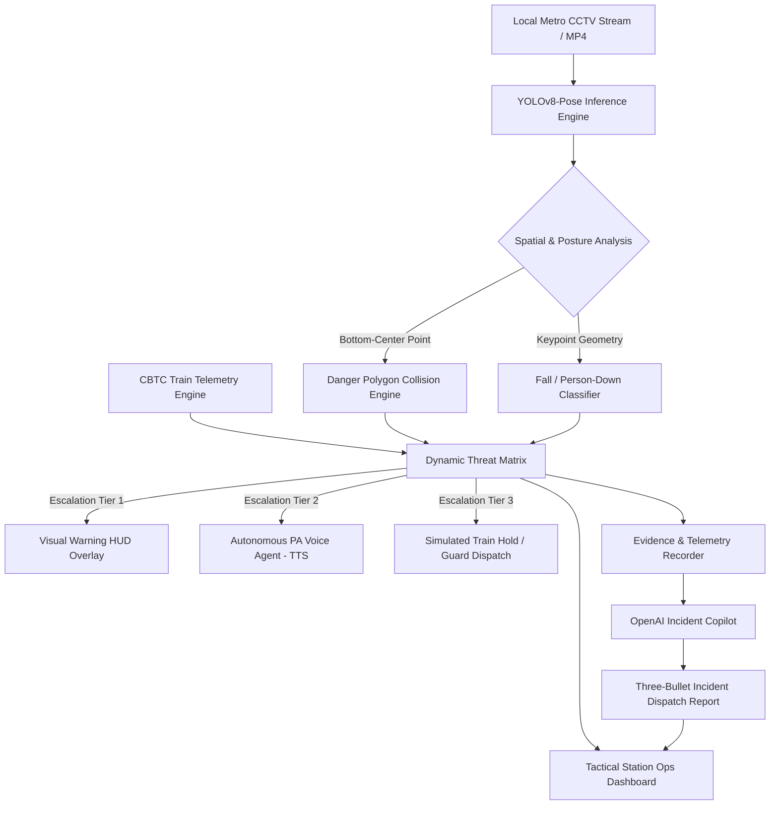

# MetroGuard AI — Product Requirements Document (PRD)
**Next-Gen Autonomous Metro Platform Safety & Operations Copilot**

---

## 1. Executive Summary & Vision

**MetroGuard AI** is an intelligent, local-first safety and incident response co-pilot for metro platform operations. Traditional CCTV is passive—recording tragedies for post-incident review. MetroGuard AI transforms passive platform CCTV into an **active, autonomous guardian** that intervenes in the critical 15–30 seconds before potential impact.

The system combines:
1. **Pose & Intrusion Vision:** YOLOv8-Pose detection to differentiate standing passengers from slips, trips, medical collapses, or persons fallen directly onto the tracks.
2. **CBTC Train Arrival Telemetry Sync:** Dynamic threat escalation based on oncoming train ETA (elevating caution to emergency train hold).
3. **Autonomous Public Address (PA) Voice Agent:** Real-time generation and playback of localized, directed audio warnings (e.g., *"Attention Platform 2: Passenger in red jacket near Door 3, please step behind the yellow line immediately. Train 104 is approaching."*).
4. **Platform Crowd Density & Surge Monitoring:** Heatmap analysis to detect dangerous bottleneck crowding near platform edges before stampedes occur.
5. **Tactical Operations Command Dashboard:** A sleek, dark-mode station controller UI with live telemetry, threat gauges, incident replay, and LLM-powered incident dispatch logs.

> [!NOTE]
> **Prototype & Hackathon Scope Disclaimer:**  
> MetroGuard AI is an operational decision-support prototype. Signalling interlocks (Train Hold / Emergency Braking) and public announcements are simulated via modular software hooks. It is not a certified SIL-4 railway safety-critical system.

---

## 2. Core Value Proposition & Hackathon Goals

- **Move Beyond Simple Object Detection:** Combine spatial polygon intrusion with skeletal posture analysis (identifying fallen persons on tracks vs. standing passengers).
- **Context-Aware Dynamic Risk Matrix:** Scale threat levels dynamically according to simulated CBTC train telemetry.
- **Action-Oriented Response:** Do not just draw boxes; trigger automated localized audio broadcasts and station marshal dispatch alerts.
- **Modern Tactical Command Center:** Deliver an impressive, operator-grade dark-mode dashboard replacing standard OpenCV developer windows.
- **Edge-First Privacy & Speed:** Keep computer vision inference 100% local on standard laptop hardware; invoke OpenAI LLM only for structured telemetry summarization and dispatch reporting.

---

## 3. System Architecture & Capabilities



---

## 4. Functional Requirements

### FR-1: Video Ingestion & Stream Engine
- **FR-1.1:** Accept user-selected local MP4 platform video files and decode frames via OpenCV.
- **FR-1.2:** Expose video metadata (current timestamp, frame index, FPS, resolution) for cross-system telemetry synchronization.
- **FR-1.3:** Handle file read errors, corrupted streams, or missing codecs gracefully with clear actionable UI messaging.
- **FR-1.4:** Provide a real-time playback regulator (simulating 25–30 FPS CCTV feed) with pause, resume, and step-frame capability.

### FR-2: Danger Zone Geometry & Interactive Visual Calibration
- **FR-2.1:** Support an $N$-sided polygon defined in pixel coordinates representing the platform edge danger zone (track bed + tactile edge).
- **FR-2.2:** Validate polygon integrity (minimum 3 non-collinear points, within frame boundary, positive area).
- **FR-2.3:** Provide an interactive or configurable calibration mechanism so coordinates can be tuned per camera angle without modifying codebase logic.
- **FR-2.4:** Dynamically render the zone overlay on the video feed:
  - **Green (Translucent):** Safe / Nominal state.
  - **Amber (Pulsing):** Loitering / Warning boundary state.
  - **Red (Flashing High-Visibility):** Active Breach / Track Intrusion.

### FR-3: Skeletal Pose Estimation & Fall-on-Track Detection
- **FR-3.1:** Execute inference using **YOLOv8-Pose** (Nano variant for high-FPS laptop performance) to detect persons and extract 17 key skeletal landmarks.
- **FR-3.2:** Maintain stable multi-object tracking across consecutive frames (ByteTrack / BoT-SORT) to track persistent individuals by persistent ID.
- **FR-3.3:** **Foot Point Localization:** Calculate reference ground contact point from ankle/heel keypoints or bottom-center bounding box.
- **FR-3.4:** **Posture & Fall Classifier:**
  - Classify orientation: Calculate angle of torso axis (shoulders to hips).
  - Trigger **"PERSON DOWN / TRACK FALL"** when:
    1. Torso orientation is substantially horizontal ($\ge 60^\circ$ tilt) inside the danger zone; OR
    2. Head and shoulder keypoints drop below the platform edge threshold onto the track bed elevation.
- **FR-3.5:** Distinguish simple yellow-line standing infractions from critical track collapse/slip emergencies.

### FR-4: CBTC Train Arrival Telemetry & Dynamic Threat Matrix
- **FR-4.1:** Provide a simulated train telemetry service providing oncoming train identification, speed, and real-time arrival countdown (ETA in seconds).
- **FR-4.2:** Compute a composite **Dynamic Threat Score ($0 - 100$)** based on:
  - Intrusion type (Standing Loiter vs. Full Track Fall).
  - Dwell time / consecutive frames inside the zone.
  - Train proximity/ETA (e.g., ETA > 3 min: Low Risk; ETA < 45s: Critical Risk).
- **FR-4.3:** Classify the operational state into three explicit tiers:
  - **Tier 1 (Caution):** Brief edge crossing ($> 15$ frames), Train ETA $> 90$s.
  - **Tier 2 (Warning):** Persistent intrusion ($> 30$ frames), Train ETA between $45\text{s} - 90\text{s}$.
  - **Tier 3 (Critical Emergency):** Track Fall detected OR Intrusion with Train ETA $< 45$s.

### FR-5: Autonomous Station Public Address (PA) Voice Agent
- **FR-5.1:** Automatically compose targeted warning announcements tailored to the active threat (e.g., location, direction, train proximity).
- **FR-5.2:** Synthesize real-time audio announcements using lightweight Edge-TTS / OpenAI Audio TTS.
- **FR-5.3:** Support bilingual or multi-lingual alert broadcasting (e.g., English and regional language).
- **FR-5.4:** Integrate audio playback directly into the dashboard with a physical mute/broadcast toggle for operator control.

### FR-6: Emergency Escalation & Signal Interlock (Simulated)
- **FR-6.1:** When Threat Tier 3 is triggered:
  - Assert simulated **"EMERGENCY TRAIN HOLD / BRAKE INTERLOCK"** command to train control.
  - Dispatch a simulated push alert to the Platform Marshal / Guard Pager containing timestamp, camera ID, and thumbnail.
- **FR-6.2:** Provide a visual indicator on the dashboard showing the interlock status (Normal / Hold Requested / Acknowledged).

### FR-7: Crowd Density & Edge Bottleneck Heatmap
- **FR-7.1:** Calculate platform crowd density index from multi-person detections across platform quadrants.
- **FR-7.2:** Generate a visual density heatmap overlay displaying crowding hotspots.
- **FR-7.3:** Alert the operator if crowd density near platform doors/edge exceeds safety thresholds ($> 80\%$ capacity), indicating stampede or accidental surge risks.

### FR-8: Evidence Packaging & AI Incident Copilot
- **FR-8.1:** Upon confirmed breach, automatically capture and archive:
  - Annotated high-res evidence frame (`evidence.jpg`).
  - Skeletal keypoint overlay snapshot (`pose_evidence.jpg`).
  - Synthesized audio announcement (`announcement.mp3`).
  - Structured machine-readable telemetry (`event.json`).
- **FR-8.2:** **OpenAI Incident Copilot Integration:**
  - Send sanitized JSON telemetry (strictly no personally identifiable video) to OpenAI API (`gpt-4o-mini`).
  - Generate a formal incident report consisting of:
    1. **Observed Facts:** Verified telemetry (timestamp, track ID, posture, dwell time, train ETA).
    2. **Threat Assessment & Severity Rating:** Evaluated operational hazard.
    3. **Standard Operating Procedure (SOP) Action Items:** Prescribed steps for the station controller.
- **FR-8.3:** Provide an offline fallback report generator if API key is missing or network is unavailable.

### FR-9: Tactical Station Operations Command Center UI
- **FR-9.1:** Provide a modern, dark-mode Station Operations Dashboard (Streamlit / Modern Web HUD) with:
  - Primary CCTV feed with toggles for Danger Zone, Skeletal Pose, and Crowd Heatmap.
  - Real-time HUD cards: Threat Level Gauge, Train ETA Countdown, Active Passenger Count, System FPS.
  - Live Incident Log feed displaying recent alerts with one-click snapshot inspection and audio replay.
  - Interactive Incident Copilot panel where operators can review AI-generated reports and ask questions (e.g., *"Summarize incidents over the last 15 minutes"*).
- **FR-9.2:** Support full keyboard shortcuts and intuitive operator controls (Space to Pause, R to Reset, M to Mute PA).

---

## 5. Non-Functional Requirements

- **Inference Performance:** Real-time or near-real-time performance ($\ge 20$ FPS) on standard quad-core laptop CPUs using YOLOv8-Pose Nano (`yolov8n-pose.pt`).
- **Local-First Privacy:** Video frames, face crops, and raw footage never leave the local environment. Only sanitized numerical telemetry is passed to the LLM.
- **Fault Tolerance:** Missing video files, disconnected internet, or failed LLM calls must not crash the detection or safety alert loop.
- **Operator Ergonomics:** Dark-mode high-contrast UI (black, slate, neon green, warning amber, emergency red) compliant with control room monitoring standards.

---

## 6. Target Output Directory Layout

```text
output/
  events/
    <event-id>/
      event.json            # Machine-readable telemetry record
      evidence.jpg          # Annotated CCTV evidence frame
      pose_overlay.jpg      # Skeletal keypoint visualization
      announcement.mp3      # Synthesized PA audio broadcast
      report.md             # AI Copilot 3-bullet incident report
```

---

## 7. Hackathon Acceptance Criteria & Demonstration Flow

A complete winning hackathon demonstration must satisfy the following script:

1. **Station Normal Operation:**
   - Launch the Tactical Command Center UI.
   - Video plays smoothly at steady FPS with a translucent green platform edge zone and real-time passenger skeletal tracking.
   - Train ETA countdown is visible and ticking down.
2. **Platform Loitering (Tier 1 / Amber):**
   - A passenger steps into the zone; zone turns amber with dwell frame counter incrementing.
3. **Critical Breach / Track Fall (Tier 3 / Red):**
   - Passenger falls or remains in the danger zone past threshold while train ETA is $< 45$s.
   - Zone flashes emergency red with visual **"CRITICAL EMERGENCY: TRACK INTRUSION"**.
   - Automated PA announcement speaks aloud: *"Attention Platform 2..."*
   - Simulated **"TRAIN HOLD ACTIVATED"** flashes on screen.
4. **Evidence & Copilot Report:**
   - Incident is immediately logged in the UI event feed.
   - Operator clicks the event to reveal the snapshot, pose diagnostic, audio playback, and instant 3-bullet OpenAI SOP incident report.

---

## 8. Technology Stack

| Layer | Technology |
|---|---|
| **Core Runtime** | Python 3.11+ |
| **Computer Vision & Video** | OpenCV (`opencv-python`) |
| **Pose & Object Detection** | Ultralytics YOLOv8-Pose (`yolov8n-pose.pt`) |
| **Multi-Object Tracking** | ByteTrack / BoT-SORT (Built-in Ultralytics) |
| **Geometry & Math** | Shapely / OpenCV `pointPolygonTest` |
| **Text-to-Speech (PA Agent)** | Edge-TTS / OpenAI Audio API |
| **Incident Copilot** | OpenAI API (`gpt-4o-mini`) + Local Fallback Template |
| **Tactical Dashboard** | Streamlit / Custom Web HUD (Dark Mode, Responsive) |
| **Configuration** | `python-dotenv`, YAML/JSON settings |
